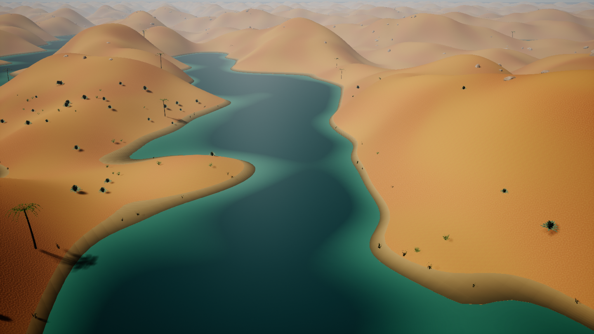
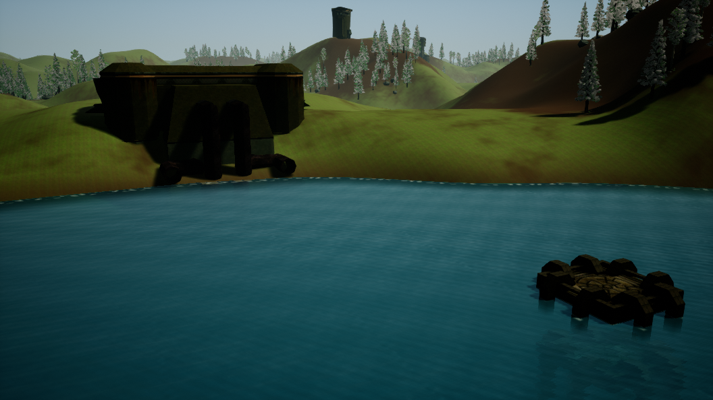

# Tribes Rivals: Clan Wars

Clan Wars is a community mod and playtest launcher for TRIBES 3: Rivals. Set up private Capture the Flag matches, join Public CTF when your host offers it, or watch a live match from first person or a chase camera.

[Download and play](#download-and-play) · [Starter screenshots](#starter-screenshots) · [Map gallery](#map-gallery) · [Developer setup](#developer-setup)



*Rollercoaster (2026) · Oasis and dune authoring preview.*

## Download and play

Use a matching Steam installation of TRIBES 3: Rivals and a player package or invitation supplied by your playtest organizer.

- **Windows Clan Wars ZIP** — Extract the entire ZIP, leave Steam signed in, and open `Start Clan Wars.bat`. Keep the `Client Files` folder beside it.
- **Linux Clan Wars package** — From the extracted folder, run `sh "Clan Wars - Linux.sh" --setup`. Enable Proton in the game's Steam properties, paste the printed line into **Launch Options**, then launch from Steam.
- **GitHub Community Starter r12 prerelease** — This is the separately published r12 playtest build. Use its release-specific install instructions and compatible server access. [Windows ZIP](https://github.com/T24085/T3FrontEndClient/releases/download/windows-2026.11.08-r12/TRIBES3-Community-Starter-Windows-20261108-r12.zip) · [Linux/Proton archive](https://github.com/T24085/T3FrontEndClient/releases/download/windows-2026.11.08-r12/TRIBES3-Community-Starter-Linux-Proton-20261108-r12.tar.gz) · [Setup and checksums](https://github.com/T24085/T3FrontEndClient/releases/tag/windows-2026.11.08-r12)

In **Lobbies**, create a room or enter a lobby code, choose teams and a map, then start the match. The first preparation checks the original Steam files. Starter reuses verified files and syncs compatible map updates from the host.

### Join or switch teams

On supported hosts, **Public CTF** shows both teams and **Auto Balance**.
While playing, **Switch to A** or **Switch to B** asks the host to move you.
Starter reconnects to the same round after your previous game closes. A
disabled choice shows the host's reason.

In **Lobbies**, **Competition**, **Scrim**, and **PUG** lock the player roster
after the match starts. Players with a reserved place can still select **Rejoin**.

## Starter screenshots

| Private lobby | Live matches |
| :--- | :--- |
| [](docs/media/starter-lobby.png) | [](docs/media/starter-live-matches.png) |
| Assign teams, pick starting sides, and configure rules offered by the host. | Select a match to watch. Use **F7** for first person, **F8** for chase view, and left or right click to switch players. |

*Starter screenshots use sample players, lobby codes, and matches.*

## Map gallery

| Stonehenge (2026) | Snowblind (2026) |
| :--- | :--- |
| [](docs/media/stonehenge-northern-lakes.webp) | [](docs/media/snowblind-winter-basin.webp) |
| Northern lakes across the valley. | Winter basin and layered snow terrain. |

| Damnation (2026) | Scarabrae (2026) |
| :--- | :--- |
| [](docs/media/damnation-basin.webp) | [](docs/media/scarabrae-lake.webp) |
| East basin from an in-game water test. | Lakeside terrain and forest authoring preview. |

| High Octane (2026) | Heavy Bolt playtest |
| :--- | :--- |
| [](docs/media/high-octane-acid.webp) | [](docs/media/heavy-bolt-playtest.webp) |
| In-game acid pool and shoreline. | In-game capture from a weapon and effects test. |

## Developer setup

The client repository contains the desktop launcher, player preparation and storage cleanup, signed updates, map sync, and client-side Lua for weather, radar, lighting, and spectating. Clone the [paired backend](https://github.com/T24085/T3BackEndServer) beside this checkout to validate shared protocol files.

Use Python 3.13 and run these commands from the repository root.

```powershell
python -m pip install -r requirements-dev.txt
python tools/check_source.py --peer ../T3BackEndServer
python -m unittest discover -s . -p "test_*.py" -v
```

[Development and release inputs](docs/DEVELOPMENT.md) · [Player release verification](docs/PLAYER-RELEASES.md) · [Current validation and known issues](docs/STATUS.md)

Game binaries, cooked maps, and private configuration are supplied separately. The gallery includes playtest captures and editor previews from different development builds. See the release notes for the contents of a particular download.
