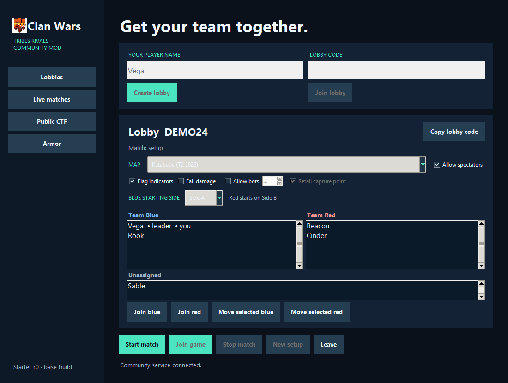
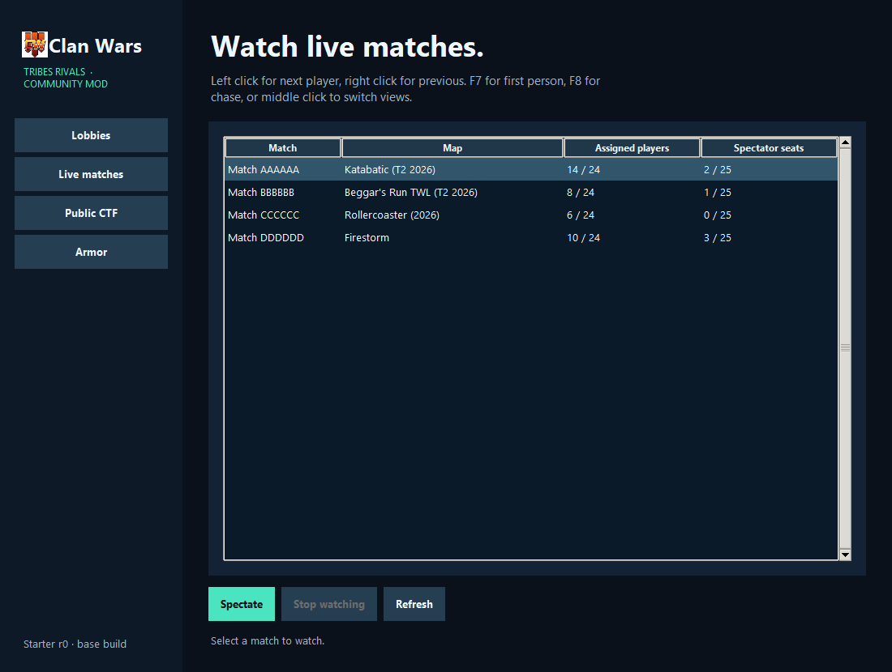
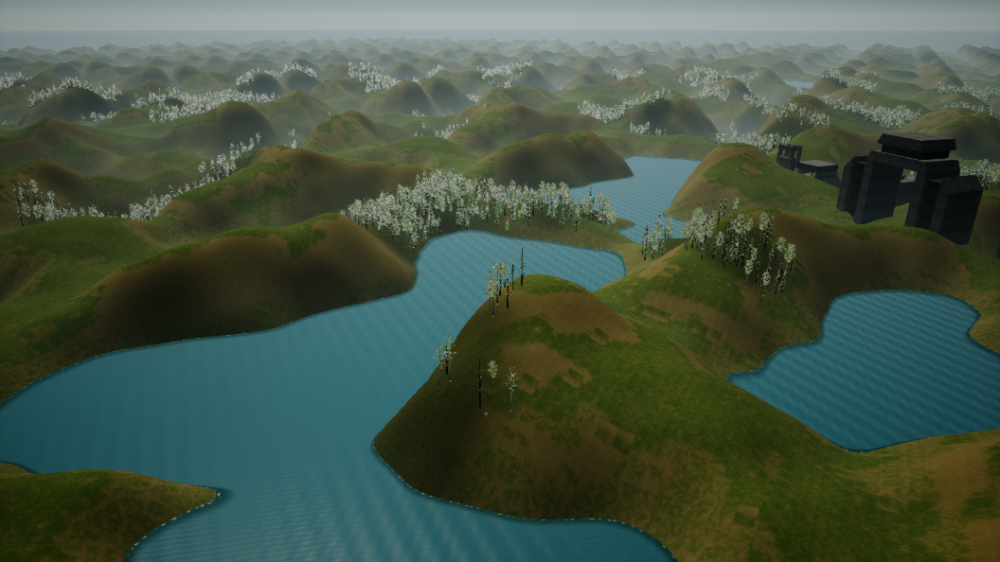
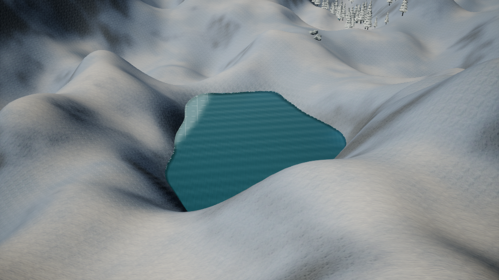
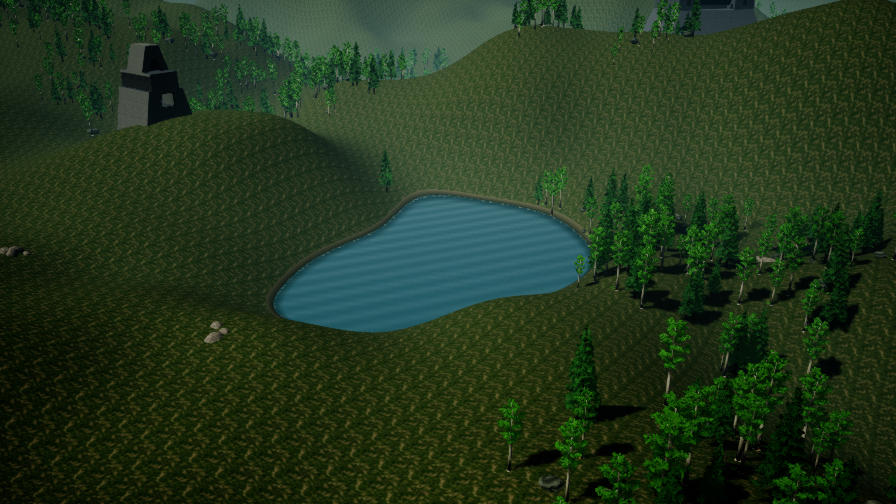
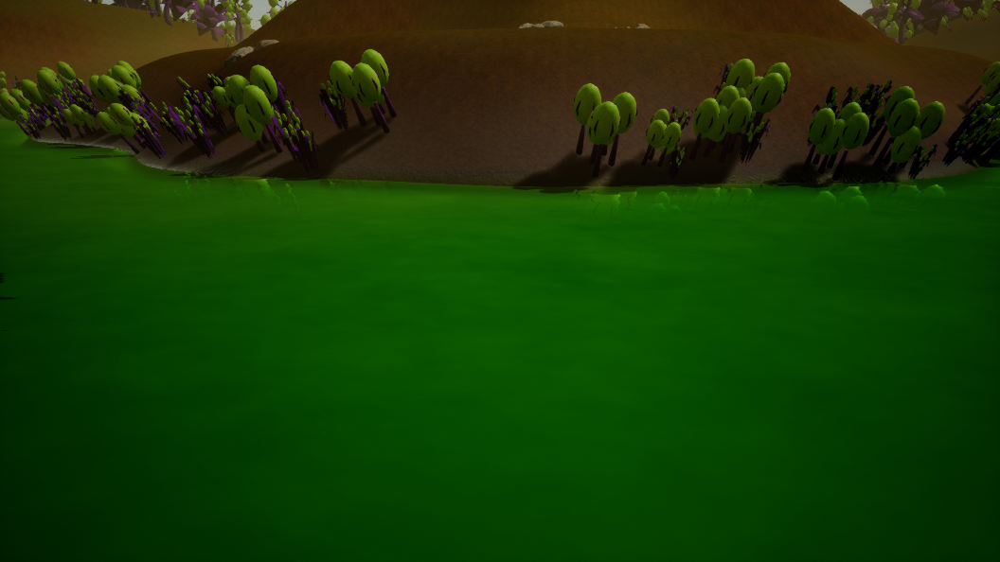
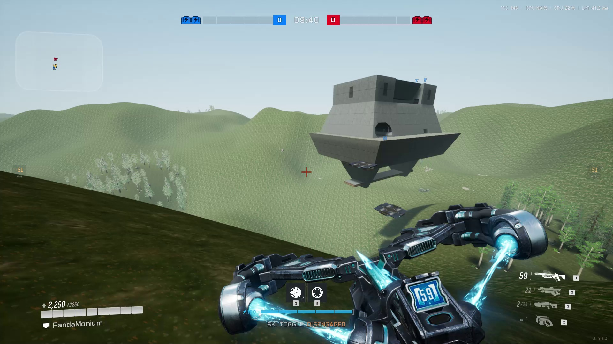

# Tribes 3 Mod Community Edition: Phoenix Rising

Phoenix Rising is a community mod and launcher for TRIBES 3: Rivals. Create private Capture the Flag lobbies, join Public CTF, or spectate a live match. The same community service supports the Windows launcher and the native Ubuntu launcher preview.

[Download and play](#download-and-play) · [Starter screenshots](#starter-screenshots) · [Map gallery](#map-gallery) · [Developer setup](#developer-setup)


*Rollercoaster (2026) · Oasis and dune authoring preview.*

## Download and play

Install TRIBES 3: Rivals in Steam and sign in. Get a current player package or invitation from your host or playtest organizer.

| Platform | First launch |
| :--- | :--- |
| Windows | Extract the entire player ZIP. Open **Start Clan Wars.bat** and keep the **Client Files** folder beside it. |
| Ubuntu native preview | Run the organizer's `.run` installer in a terminal. Complete **Steam Setup** in Starter, then put its generated line in the game's Steam **Launch Options**. Open **Start Clan Wars Ubuntu.sh** from the installed folder for later sessions. [Desktop shortcut and troubleshooting](docs/LINUX_NATIVE_LAUNCH.md) |

The launcher verifies the original Steam files on first use and can reuse verified files later. An enrolled launcher receives signed updates for its platform and verifies required maps from the host.

The [GitHub Community Starter r12 prerelease](https://github.com/T24085/T3FrontEndClient/releases/tag/windows-2026.11.08-r12) contains the November 8 Windows and Linux/Proton packages. Use the instructions and server access for that release.

## Play and spectate

- **Lobbies** — Create a lobby or join by code. The lobby shows Children of The Phoenix and Diamond Sword. The host controls available maps, rules, and spectator access.
- **Public CTF** — Join an open team or request a balanced seat when the host offers Public CTF. Bots fill open playing slots and players can vote on the next map.
- **Server Browser** — Browse live matches and select **Spectate** when seats are available.
- **Maps, Armor, and Settings** — Browse the host map catalog, preview and save armor choices, and configure supported options such as proximity voice and keybind import.

## Current release source

The November 22 Direct rollout was verified with Windows Starter r76 and Ubuntu Preview 7 signed update 9. The changes added team selection and rosters for Public CTF on both platforms and kept the map catalog visible during downloads.

| Platform | Published source |
| :--- | :--- |
| Windows Starter r76 | [Windows release changes](https://github.com/T24085/T3FrontEndClient/commit/c13f455fc92f119fbdc6cd30d8e7e49392b4a6f5) |
| Ubuntu Preview 7 update 9 | [Ubuntu release changes](https://github.com/T24085/T3FrontEndClient/commit/34efaa9) |

The [paired backend](https://github.com/T24085/T3BackEndServer) documents host setup and the server components used for the rollout.

### Join or switch teams

On supported hosts, **Public CTF** shows both teams and **Auto Balance**.
While playing, **Switch to A** or **Switch to B** asks the host to move you.
Starter reconnects to the same round after your previous game closes. A
disabled choice shows the host's reason.

In **Lobbies**, **Competition**, **Scrim**, and **PUG** lock the player roster
after the match starts. Players with a reserved place can still select **Rejoin**.
If a lobby leader restarts the match, reserved players can rejoin the replacement
on their original team.

A Direct package with directory seeds adds **Community servers**. Connect to
a host that offers open Public CTF registration, or use the selected host's
invitation. The browser keeps a saved view for master outages and can measure
ping to a selected server.

The [paired backend branch](https://github.com/T24085/T3BackEndServer/tree/feat/phoenix-rising-issue-integration) supports these lobby and map options. The [verification status](docs/STATUS.md) covers the CTF scorebar, generator icons, flag carrier names, and minimap markers in this branch.

## Starter screenshots

| Private lobby | Live matches |
| :--- | :--- |
| [](docs/media/starter-lobby.png) | [](docs/media/starter-live-matches.png) |
| Assign teams, pick starting sides, and configure rules offered by the host. | Select a match to watch. Use **F7** for first person, **F8** for chase view, and left or right click to switch players. |

*Starter screenshots use sample players, lobby codes, and matches.*

## Map gallery

| Stonehenge (2026) | Snowblind (2026) |
| :--- | :--- |
| [](docs/media/stonehenge-northern-lakes.webp) | [](docs/media/snowblind-winter-basin.webp) |
| Northern lakes across the valley. | Winter basin and layered snow terrain. |

| Damnation (2026) | Scarabrae (2026) |
| :--- | :--- |
| [](docs/media/damnation-basin.webp) | [](docs/media/scarabrae-lake.webp) |
| East basin from an in-game water test. | Lakeside terrain and forest authoring preview. |

| High Octane (2026) | Heavy Bolt playtest |
| :--- | :--- |
| [](docs/media/high-octane-acid.webp) | [](docs/media/heavy-bolt-playtest.webp) |
| In-game acid pool and shoreline. | In-game capture from a weapon and effects test. |

## Developer setup

The client repository contains the desktop launcher, player preparation and storage cleanup, signed updates, map sync, and client-side Lua for weather, radar, lighting, and spectating. Clone the [paired backend](https://github.com/T24085/T3BackEndServer) beside this checkout to validate shared protocol files.

Use Python 3.13 and run these commands from the repository root.

```powershell
python -m pip install -r requirements-dev.txt
python tools/check_source.py --peer ../T3BackEndServer
python -m unittest discover -s . -p "test_*.py" -v
```

[Development and release inputs](docs/DEVELOPMENT.md) · [Player release verification](docs/PLAYER-RELEASES.md) · [Current validation and known issues](docs/STATUS.md)

Game binaries, cooked maps, and private configuration are supplied separately. The gallery includes playtest captures and editor previews from different development builds. See the release notes for the contents of a particular download.
